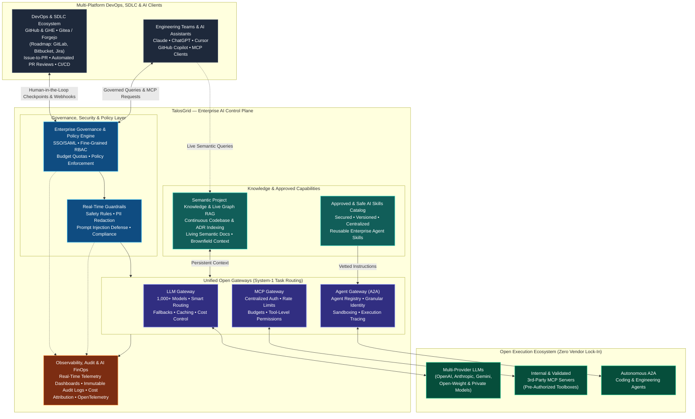

# TalosGrid

### The Enterprise Control Plane for AI-Agentic Software Development

**Orchestrate LLMs, MCP servers, and A2A agents with built-in guardrails, granular access control, and full compliance with corporate policies.**

[Why TalosGrid](#-why-talosgrid) • [Business Value](#-enterprise-value--business-impact) • [Methodology](#-beyond-vibe-coding-governed-spec-driven-sdlc) • [Architecture](#-platform-architecture) • [Capabilities](#-core-platform-capabilities) • [Integrations](#-ecosystem--integrations) • [Get Started](#-get-started)

---

## Why TalosGrid?

Adopting autonomous AI agents and LLMs in enterprise software engineering introduces a critical paradox: **velocity without governance creates operational risk.**

Unstructured, prompt-driven *"vibe coding"* relies on ephemeral context windows, isolated IDE chats, and ungoverned shadow agents. At enterprise scale, this leads to architectural drift, legacy regressions, unbudgeted token spend, security exposure, and mounting technical debt.

**TalosGrid** bridges the gap between AI-agentic autonomy and enterprise-grade control. It provides a centralized, multi-tenant **Control Plane** that embeds policy enforcement, real-time guardrails, semantic project memory, and end-to-end observability directly into your existing Software Development Lifecycle (SDLC).

---

## Enterprise Value & Business Impact

TalosGrid transforms AI-assisted coding from isolated team experiments into a **predictable, auditable, and scalable engineering capability**.

| Business Dimension | Enterprise Value Delivered by TalosGrid |
| :--- | :--- |
| **Governance & Compliance** | Enforce corporate policies, SSO/SAML, fine-grained RBAC, and complete audit trails across every team, repository, model, and agent—eliminating Shadow AI. |
| **Security & Risk Mitigation** | Prevent data leaks and unauthorized actions via real-time PII redaction, prompt injection defense, sandboxed agent execution, and pre-authorized MCP toolboxes. |
| **Deterministic Delivery** | Replace ad-hoc prompting with living specifications and human-in-the-loop Git checkpoints, ensuring AI-generated code respects system boundaries and clean core principles. |
| **Brownfield & Legacy Readiness** | Maintain persistent architectural context across complex, multi-repo codebases via a live Semantic Knowledge Graph—preventing regressions during refactoring and reverse engineering. |
| **Cost Control & AI FinOps** | Track and attribute token consumption with real-time telemetry, budget quotas, intelligent model routing, and caching across projects and teams. |
| **Zero Vendor Lock-In** | Stay future-proof with an open orchestration layer supporting 1,000+ LLMs, custom or third-party MCP servers, A2A agents, and multiple DevOps platforms. |

---

## Beyond Vibe Coding: Governed Spec-Driven SDLC

TalosGrid replaces fragile, chat-based code generation with a structured **Spec-Driven Agentic SDLC**:

| Dimension | Ad-Hoc "Vibe Coding" | TalosGrid Spec-Driven Agentic SDLC |
| :--- | :--- | :--- |
| **Context Management** | Ephemeral token windows; frequent context loss | Persistent **Semantic Knowledge Graph + Live Graph RAG** |
| **Control & Governance** | Unmanaged prompts and shadow agents | Centralized **Policy Engine, RBAC, and Real-Time Guardrails** |
| **Tool & Infra Access** | Unrestricted or inconsistent local permissions | **Pre-authorized MCP Gateways** with tool-level permissions & rate limits |
| **Codebase Fit** | High architectural drift; risky on brownfield repos | Architecture-first execution safe for both **greenfield & brownfield** |
| **Human Oversight** | Manual, ad-hoc copy-paste review | Native **DevOps Human-in-the-Loop** checkpoints & automated PR governance |
| **Auditability & Cost** | Opaque usage and unpredictable spend | Full **OpenTelemetry tracing**, audit logs, and budget quotas |

---

## Platform Architecture

TalosGrid sits as an open, vendor-agnostic **Enterprise Control Plane** between your engineering workflows and the underlying AI execution ecosystem—enforcing governance, semantic context, and real-time guardrails on every interaction.

---

## Core Platform Capabilities

Every capability in TalosGrid is engineered to be **open, modular, and vendor-agnostic**:

### Governance, Security & Policy
* **Enterprise Governance & Policy Engine:** Core control plane featuring SSO/SAML integration, fine-grained Role-Based Access Control (RBAC), budget quotas, audit trails, and centralized policy enforcement across teams, repositories, and agents.
* **Real-Time Guardrails:** Enforce safety rules, PII redaction, prompt injection defense, and corporate compliance policies inline on every request.
* **Approved & Safe AI Skills Catalog:** Secure, version, centralize, and distribute vetted, reusable AI agent skills across engineering teams.

### Unified Gateways & Orchestration
* **LLM Gateway:** Unified access to **1,000+ models** across major providers with intelligent task routing, automated fallbacks, caching, and token cost control.
* **MCP Gateway:** Connect internal and validated third-party Model Context Protocol (MCP) servers with centralized authentication, rate limits, budgets, and granular tool-level permissions.
* **Agent Gateway (A2A):** Register and orchestrate Agent-to-Agent (A2A) workflows with granular identity management, sandboxing, and end-to-end execution tracing.

### Knowledge & Observability
* **Semantic Project Knowledge & Live Graph RAG:** Continuously index codebases, architecture decisions, and project documentation into a living semantic Knowledge Graph—always up to date and queryable by human engineers and AI assistants (Claude, ChatGPT, Cursor, Copilot, and MCP clients).
* **Observability & Telemetry:** Built-in real-time telemetry dashboards, immutable audit logs, granular cost attribution, and native **OpenTelemetry** support out of the box.

---

## Ecosystem & Integrations

TalosGrid embeds directly into your existing engineering stack—without forcing a rip-and-replace of your tools:

* **DevOps & SDLC Platforms:** Repository-level governance, automated PR reviews, issue-to-PR orchestration, and CI/CD pipeline triggers.
  * **Supported:** GitHub, GitHub Enterprise, Gitea / Forgejo (Open Source)
  * **Roadmap:** GitLab, Bitbucket, Jira
* **AI Assistants & Clients:** Query the live Semantic Knowledge Graph via Claude, ChatGPT, Cursor, GitHub Copilot, and any MCP-compatible client.
* **Standards & Protocols:** Model Context Protocol (MCP), Agent-to-Agent (A2A), OpenTelemetry, SSO/SAML.

---

## Get Started

Transition your engineering organization from isolated AI experiments to governed, production-grade autonomous software delivery.

* **Explore the Platform:** [www.talosgrid.ai](https://www.talosgrid.ai)
* **Free Trial:** Evaluate TalosGrid with a **14-day free trial** on all paid plans (no credit card required).
* **Enterprise Architecture & Inquiries:** Reach out at [info@talosgrid.ai](mailto:info@talosgrid.ai) or schedule an architecture call via the website.

---

  © 2026 TalosGrid — Governed AI-Agentic Software Development.

